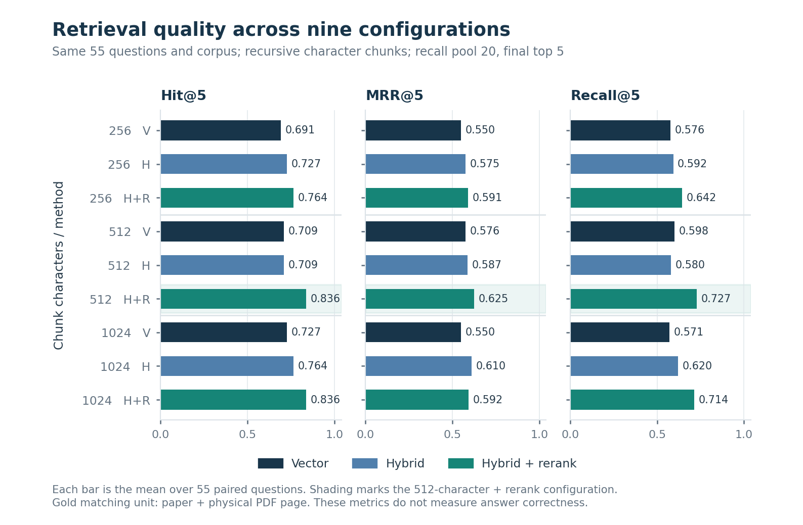
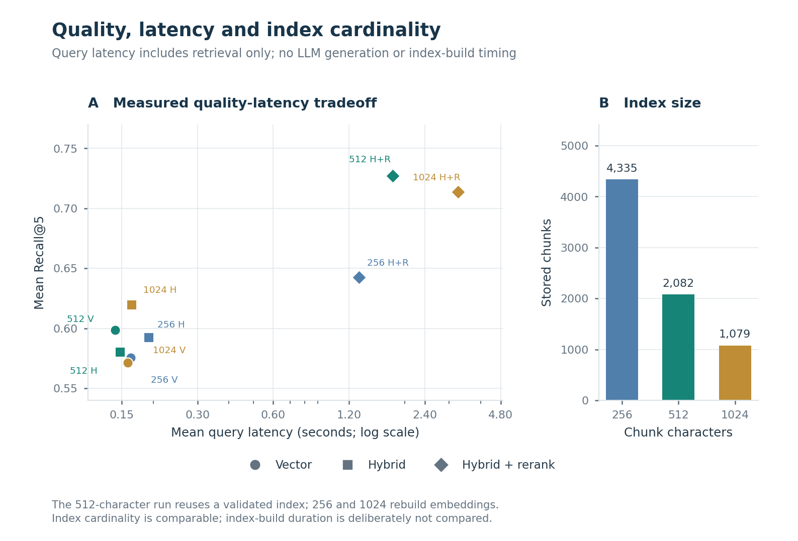
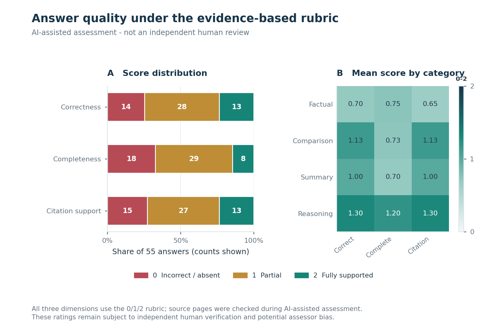

# 智能科研助理：代码、评测与课程报告

南京农业大学课程实践项目，采用本地 RAG、Agent 工具调用和 Streamlit 界面。项目代码位于 [`rag_project_20261007/rag_project`](rag_project_20261007/rag_project/)。

本次同步成员 B 的模块五工作：评测与恢复代码、55 题数据、正式实验结果、AI 辅助评分审计，以及完整 LaTeX 报告。原有 A/C/D 代码保留在项目中。

## 交付入口

| 内容 | 入口 |
|---|---|
| 完整报告（28 页 PDF） | [main.pdf](rag_project_20261007/rag_project/B_Module5_Report_20261014/main.pdf) |
| LaTeX 源文件、8 组图和数据表 | [独立报告文件夹](rag_project_20261007/rag_project/B_Module5_Report_20261014/) |
| 可整体下载的报告包 | [B_Module5_Report_20261014.zip](rag_project_20261007/rag_project/B_Module5_Report_20261014.zip) |
| 55 题问题、参考答案与证据页 | [qa_questions.md](rag_project_20261007/rag_project/evaluation/qa_questions.md) · [qa.jsonl](rag_project_20261007/rag_project/evaluation/qa.jsonl) |
| 评分依据与逐题审计 | [AI 评分报告](rag_project_20261007/rag_project/evaluation/ai_review_20261014_191222/AI评分报告.md) · [scores_audit.json](rag_project_20261007/rag_project/evaluation/ai_review_20261014_191222/scores_audit.json) |
| 检索参数实验 | [对比报告](rag_project_20261007/rag_project/evaluation/retrieval_comparison_20261014_214329/检索参数对比报告.md) · [比较数据](rag_project_20261007/rag_project/evaluation/retrieval_comparison_20261014_214329/comparison.json) |
| 课程验收与下一轮优化 | [优化交接](rag_project_20261007/rag_project/evaluation/retrieval_comparison_20261014_214329/下一轮优化交接.md) |
| 本次同步范围与验证 | [GitHub 同步记录](rag_project_20261007/rag_project/docs/github_sync_20261015.md) |

## 已测结果

固定语料为 **15 篇、296 个物理页**，评测集共 **55 题**：事实 20、对比 15、总结 10、推理 10。Agent 基线保留 2 个执行失败；独立检索实验为 3 档长度 × 3 种检索 × 55 题，共 495 条。

| 指标 | 本轮结果 | 含义 |
|---|---:|---|
| Agent 执行成功 | 53/55（96.36%） | 后端执行状态，不是答案正确率 |
| 自动工具集合匹配 | 46/55（83.64%） | 与固定可接受工具集合匹配 |
| AI 语义路由判断 | 45/55（81.82%） | 同时考虑工具、意图与参数 |
| 平均问答时延 | 64.096 秒 | 逐题测量，包含保留的失败结果 |
| 平均 Token 消耗 | 4394.6 | 55/55 题计量完整 |
| AI 正确性 / 完整性 / 引用准确性 | 0.9818 / 0.8182 / 0.9636 | 各项满分 2，尚待独立人工复核 |

| 分块长度 + 混合重排 | Hit@5 | MRR@5 | Recall@5 | 平均查询时延 |
|---|---:|---:|---:|---:|
| 256 字符 | 42/55（76.36%） | 0.5906 | 64.24% | 1.3116 秒 |
| 512 字符 | 46/55（83.64%） | 0.6245 | 72.73% | 1.7860 秒 |
| 1024 字符 | 46/55（83.64%） | 0.5921 | 71.36% | 3.2577 秒 |

这三档全部使用 **recursive 字符分块**，不是三类分块策略的质量实验。512 档复用了校验通过的已有索引，不能拿零建库时间与新建索引比较。以上是单次固定题集的观察结果，不代表普遍最优，也不代表已经完成生成/Agent 修复后的优化复测。







## 使用代码与复查结果

使用已有 Python 环境，在项目目录执行：

```powershell
cd rag_project_20261007\rag_project
python scripts\run55.py --check-only
```

该命令检查评测集与本地语料。原始论文未在本次同步中上传；首次克隆需根据 [`corpus_manifest.json`](rag_project_20261007/rag_project/evaluation/corpus_manifest.json) 将对应 PDF 放到 `evaluation/corpus/`，否则检查会报告缺少文件。文件名、物理页码和 SHA-256 保留用于核验。

准备好原有依赖、BGE 模型与 Ollama 的 `qwen2.5:7b` 后，可新建一轮实验：

```powershell
python scripts\run55.py --context-size 4096
python scripts\run55.py --mode retrieval --chunk-size 512
```

每次运行写入新目录。旧结果只读保留；`--reuse-index` 只适用于本机仍存在且通过校验的索引，本仓库不分发向量存储。运行、续跑和异常诊断详见 [B 的运行方案](rag_project_20261007/rag_project/docs/member_B_runbook.md)。

直接阅读报告、编译 LaTeX 和从报告快照重建图表，均不需要原始论文、Ollama 或向量库；具体命令见 [报告 README](rag_project_20261007/rag_project/B_Module5_Report_20261014/README.md)。前端和原后端说明见 [项目 README](rag_project_20261007/rag_project/README.md)。

## 结果来源与验收边界

- 正式 Agent 结果为 `agent55_20261014_175735_da23d1`。其中 23 题保留自中断运行，另执行 32 题；来源目录一并保存，统计不重复计数。
- 三组检索分别为 `retrieval55_20261014_193104_b35edd`（512）、`retrieval55_20261014_210831_0865ca`（256）、`retrieval55_20261014_212257_280fb9`（1024）。
- Agent 原运行目录里的 `summary` 是评分前快照；质量分数请使用 `ai_review_20261014_191222/summary/`，避免混用。
- 原始元数据中的 Windows 路径是历史运行来源，保留用于审计；它们不是其他机器的安装路径。
- 独立人工复核、质量优化前后复测、三类分块策略的检索质量比较，以及模板要求的 3–5 张真实界面截图仍待补齐。报告中的数据图和架构图不替代真实界面截图。
